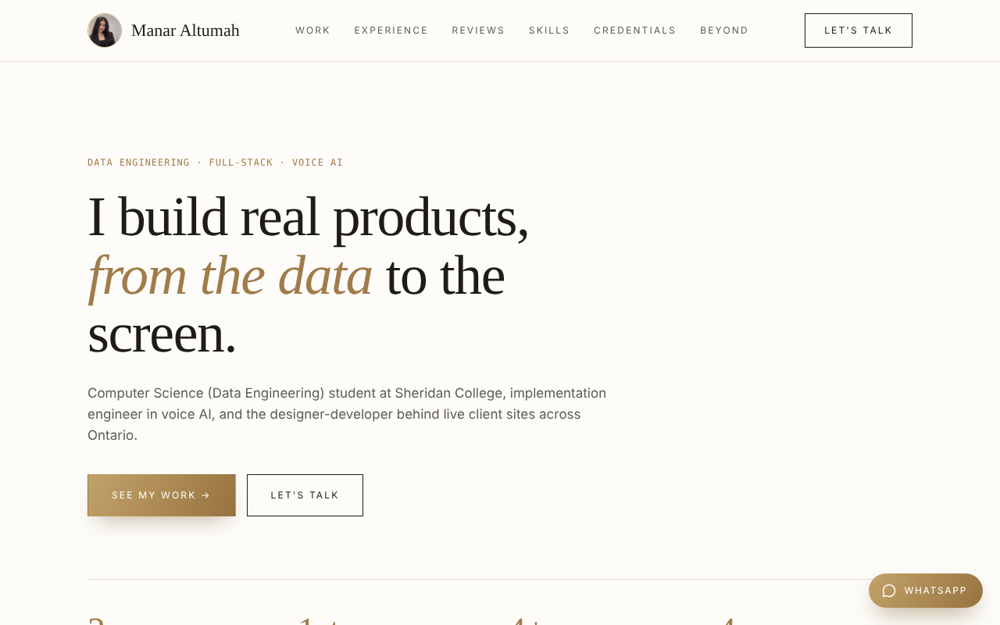

# Manar Altumah — Portfolio

**Live:** [manar-altumah.netlify.app](https://manar-altumah.netlify.app)

My personal portfolio: projects, experience, recommendations and a little about life outside code. Designed and hand-coded in an ivory and gold editorial style, with separate pages for work, experience, reviews, skills, credentials and life beyond code.



## Highlights

- Project showcase with live screenshots that link straight to each site
- Recommendations section, photo gallery with a lightbox, and scroll-reveal animations
- Floating WhatsApp button and one-click email copy
- Fully responsive, from desktop down to small phones
- Contact form powered by Netlify Forms, with an email fallback
- One HTML file with no frameworks and no build step

## Tech

`HTML5` · `CSS3` · `Vanilla JavaScript` · `Netlify`

## Run locally

```bash
npx serve .
```

---

**Manar Altumah** · [LinkedIn](https://www.linkedin.com/in/manar-a-4b776030a) · altumahmanar@gmail.com

## License

© 2026 Manar Altumah. **All rights reserved.** This code is shared for portfolio viewing only and may not be copied, reused or sold. See [LICENSE](LICENSE).
